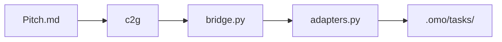

# c2g — Architecture

> **Layer**: X 横切框架  
> **Role**: 战略需求引擎 — Concept-to-Goal / Pitch → Bet → Task  
> **Stack**: Python 3.13+, uv, fastmcp, pydantic  
> **Health**: See local CI and smoke verification
> **SSOT**: 运行时健康、入口成熟度以本项目 CI、smoke 验证和 workspace governance SSOT 为准
>
> 系统全景参见：[`../../docs/PANORAMA.md`](../../docs/PANORAMA.md)

---

## 1. 内部架构



## 2. 入口

| Type | Entry | Port / Notes |
|:--|:--|:--|
| CLI | `c2g` | brainstorm/draft (`--scenario` 场景化, BET-6)/bet/radar/gc |
| MCP stdio | `c2g-mcp` | c2g_bet, c2g_radar, c2g_gc |

## 3. 核心模块

| Module | Responsibility |
|:--|:--|
| `src/c2g/cli.py` | CLI entry (`brainstorm` / `bet` / `radar` / `gc`) |
| `src/c2g/mcp_server.py` | FastMCP server |
| `src/c2g/bridge.py` | Legacy Pitch → Bet/Task import |
| `src/c2g/bridge_import.py` | [C2G v4] Pitch frontmatter parsing + Bet/Task materialization |
| `src/c2g/strategy.py` | radar audit + gc |
| `src/c2g/scenarios.py` | [BET-6] 场景注册表 (6 场景 Pitch 模板: gongwen/vault/research/family/health/finance) |
| `src/c2g/ports.py + adapters.py` | IOC + ecos/omo adapter |

## 4. 测试

```bash
cd projects/c2g && uv run pytest tests/ -q
```
