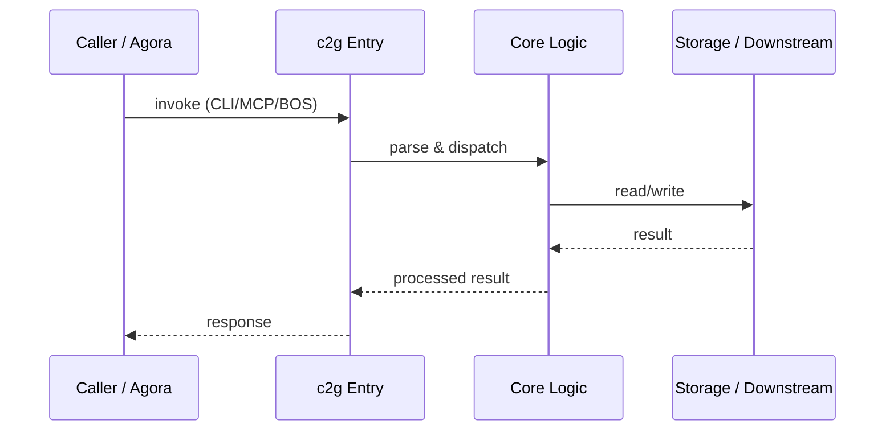

# c2g — Call Chain

> 本文档描述 c2g 内部最核心的一条调用链 / 数据流。
>
> 通用跨层调用链参见：[`docs/I0-AGORA-CALLCHAIN.md`](../docs/I0-AGORA-CALLCHAIN.md)

---

## 关键路径

### V2P: `c2g brainstorm <topic>`

1. User runs `c2g brainstorm "AI 驱动的代码审查助手"`
2. `cli.py` slugifies topic and resolves `pitches/` directory
3. A structured Pitch template is written to `pitches/Idea-<slug>.md`
4. User fills in background, goals, boundaries and required frontmatter

### C2G v4: `c2g bet <pitch.md>`

1. User runs `c2g bet ./pitches/Idea-<slug>.md`
2. `bridge_import.py` parses leading blockquote frontmatter for `Upstream` and `Appetite`
3. `adapters.py` loads governance provider from ecos/omo
4. A Bet (Goal) is saved to `.omo/goals/current.yaml`
5. `llm.py` extracts structured tasks from the pitch body
6. `task_builder.py` generates OMO planned task YAML
7. Result written to `.omo/tasks/planned/`

## Sequence Diagram

