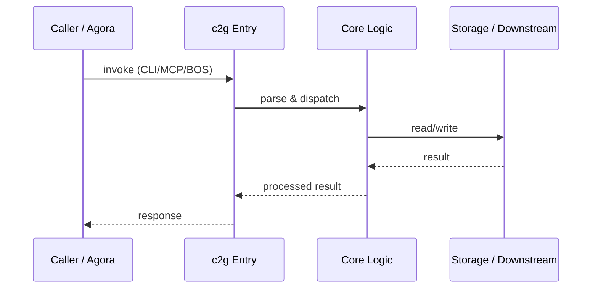

# c2g — Call Chain

> 本文档描述 c2g 内部最核心的一条调用链 / 数据流。
>
> 通用跨层调用链参见：[`docs/I0-AGORA-CALLCHAIN.md`](../docs/I0-AGORA-CALLCHAIN.md)

---

## 关键路径

1. 1. User runs `c2g bet <pitch.md>`
2. 2. `bridge.py` parses pitch and resolves OMO directory
3. 3. `adapters.py` loads governance provider from ecos/omo
4. 4. `task_builder.py` generates OMO task YAML
5. 5. Result written to `.omo/tasks/planned/`

## Sequence Diagram

